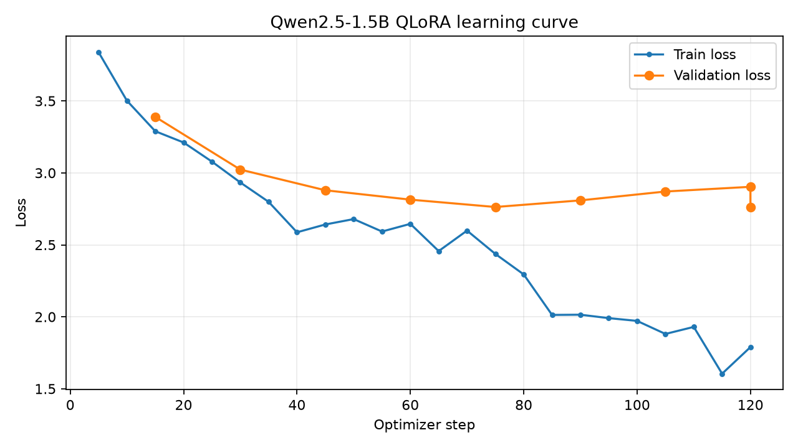
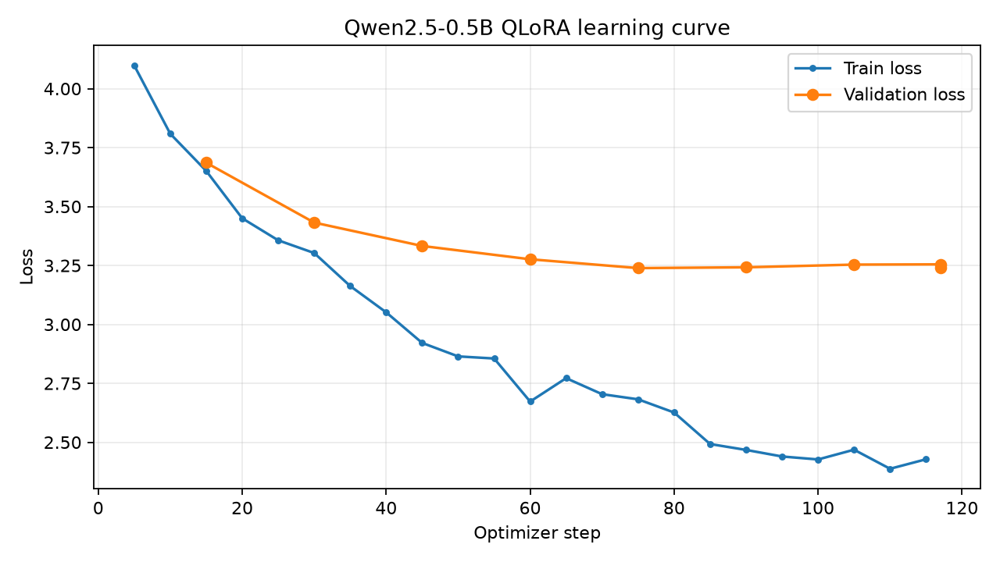

# hw2-chinese-flirty-chat-qlora

繁體中文土味情話多輪對話作業，以 Qwen2.5-0.5B／1.5B-Instruct 進行 4-bit QLoRA 微調。這是依照課堂 [`cases/llm_finetune`](https://github.com/telunyang/python_nlp/tree/main/cases/llm_finetune) 流程改寫的獨立專案。固定的繁體中文 system prompt 定義在 `common.py`，資料與推論共用它。目標是讓模型以溫和、幽默的方式接住追問，並尊重對方的界線。

倉庫包含兩版已訓練的 LoRA adapter、候選語料、訓練指標與實際對照。**目前是初版實驗成果：已跑通多輪訓練與推論，接梗、幽默及限制理解仍不穩定。**

## 成果摘要

| 模型 | 訓練／驗證樣本 | 實際步數／圈數 | 最佳 validation loss | 最佳 checkpoint |
| --- | --- | --- | --- | --- |
| Qwen2.5-0.5B | 612／68 | 117／3.00 | 3.2388 | step 75 |
| Qwen2.5-1.5B | 612／68 | 120／1.56，提早停止 | 2.7629 | step 75 |

兩版最多設定 3 epochs，每 15 步評估；連續三次未改善時停止，最後載回最低 validation loss 的 adapter。1.5B 在相同留出資料上 loss 較低，五輪示範可延續小燈、沒電與下雨的話題，但仍有「三天無法視訊」卻約明天等錯誤。loss 改善不代表已具備穩定的情話品質。

- [1.5B：五組兩輪模型對照與五輪展示](results/comparison_15b.md)
- [0.5B：模型對照與展示](results/comparison.md)
- [完整實作方式與過程](docs/作業二.md)




## 資料

`make_raw.py` 內有 17 個情境、每個情境 10 組由 AI 撰寫的原創梗與接續回覆；每組以兩種不同開場展開，所以 `raw/*.json` 共 **340 段候選對話**、每段 **2 輪**。情境是初識、告白、約會、道歉、吃醋、早安、晚安、下雨、節日、考試、職場、遠距、被拒絕、忙碌、日常、冷笑話、心情低落。

`build_corpus.py` 驗證角色交替、非空訊息、至少兩輪，以第一個 user 訊息去重，並用 OpenCC `s2twp` 轉繁體。`prepare_chat_data.py` 先按「相同回覆的梗」分組再以 seed 42 切成約 90/10，避免同一梗的兩種開場跨到訓練與驗證集；再將每次 assistant 回覆展開為 prompt/completion，最多保留最近 6 則對話訊息及固定 system prompt。

**審核狀態：**這批資料由 AI 撰寫並經程式格式檢查，尚未由人逐筆審核。它可用來驗證訓練流程及作為初版展示；正式繳交前應逐筆確認幽默品質、重複度與是否尊重對方。兩種開場共用同一梗，因此語料的獨立梗數是 170，不應把 340 視為 340 個獨立梗。

`data/review.csv` 每個梗一列，`approved` 留白表示待審。人工逐筆看過後填 `yes` 或 `no`，再執行 `python build_corpus.py --approved-only`、`python prepare_chat_data.py` 及重新訓練，才能得到審核後版本。`make_raw.py` 重新產生資料時只會保留內容雜湊相同的審核決定；改過文字的梗須重新審核。

## 安裝與執行（Windows PowerShell）

需要 Python 3.12、NVIDIA CUDA GPU，並可下載 Hugging Face 的 `Qwen/Qwen2.5-0.5B-Instruct`。本機使用 GTX 1660 Ti 6 GB、PyTorch CUDA 12.8、FP16；不啟用 BF16。若 Windows 的 bitsandbytes 4-bit 載入失敗，可改在 WSL2 執行同一套腳本。

```powershell
git clone https://github.com/jajameme/hw2-chinese-flirty-chat-qlora.git hw2_flirty_chat
cd hw2_flirty_chat
py -3.12 -m venv .venv
.\.venv\Scripts\Activate.ps1
python -m pip install torch==2.11.0 --index-url https://download.pytorch.org/whl/cu128
python -m pip install -r requirements-training.txt
```

使用倉庫附上的 adapter 聊天，不必先重新訓練。首次使用會下載 Qwen 基礎模型；輸出會用 OpenCC 轉繁體：

```powershell
python infer_lora_chat.py --model-size 1.5b
# 或使用 0.5B 初版
python infer_lora_chat.py --model-size 0.5b
```

從候選語料重現 0.5B 訓練與比較：

```powershell
python make_raw.py
python build_corpus.py
python prepare_chat_data.py
python check_gpu.py
python train_qlora.py
python plot_loss.py
python compare_base.py
python render_demo.py
python infer_lora_chat.py
```

`requirements-training.txt` 是直接依照課堂版本固定的必要套件；`requirements.txt` 記錄本機完整安裝版本。模型下載只需首次執行，但需要可存放模型權重的磁碟空間。

所有入口預設共用專案的 `.cache/huggingface`；若自行設定 `HF_HOME`，背景執行前請在同一快取先跑過 `check_gpu.py --model-size 1.5b`。背景訓練使用離線模式，需先完成模型下載。圖像排版需要微軟正黑體，或程式列出的 Noto Sans CJK 字型路徑。

## 訓練設定

| 項目 | 設定 |
| --- | --- |
| 模型 | `Qwen/Qwen2.5-0.5B-Instruct` |
| 量化 | 4-bit NF4、double quantization、FP16 compute |
| LoRA | rank 8、alpha 16、dropout 0.05、all-linear |
| 序列長度 | 512 tokens |
| batch / gradient accumulation | 4 / 4 |
| epochs | 3，依 validation loss 提早停止 |
| learning rate / optimizer | 1e-4 / `paged_adamw_8bit` |
| supervision | 只對 assistant completion 計算 loss；EOS `<|im_end|>` |
| 評估與儲存 | 每 15 optimizer steps；挑最低 eval loss |

若顯示 CUDA out of memory，可從 `python train_qlora.py --batch-size 2 --grad-accum 8 --gradient-checkpointing` 開始。`--max-steps 2` 只供環境 smoke test，不代表完整訓練。

## 產物與檢查

- `data/chat.jsonl`：通過格式檢查的完整對話。
- `data/sft/train.jsonl`、`valid.jsonl`：展開後訓練/驗證樣本。
- `outputs/flirty_lora_05b/`：LoRA adapter、tokenizer、`metrics.json`。
- `images/loss_curve.png`：訓練與驗證 loss。
- `results/comparison.md`、`comparison.json`：五組兩輪基礎模型／微調模型對照，另有五輪接梗展示。
- `images/demo_chat.png`：將真實五輪模型輸出排版成可分享的圖片，並標示為逐字稿排版圖。

比較腳本固定相同 system prompt 並使用貪婪解碼。第二輪各自帶入該模型的第一輪答案，所以可以觀察是否延續上下文。自動產出的文字仍需人工評估自然度、幽默感與界線。

本機完整訓練用時約 21 分 23 秒，共 117 optimizer steps；最低 validation loss 為 **3.2388**（第 75 步）。第 90、105、117 步的 validation loss 略回升，因此最終 adapter 選第 75 步。PyTorch 記錄訓練峰值顯存 2.86 GiB（不含其他行程），LoRA 權重約 16.82 MiB。



實際五組追問顯示此 0.5B adapter 的語氣更簡短溫和，但仍有明顯答非所問，尤其天文館與道歉題；目前只算跑通流程，品質尚未達到穩定接梗。完整逐字稿在 [results/comparison.md](results/comparison.md)。


## 1.5B 第二輪

由於 0.5B 的實際回答未穩定接梗，程式也支援 `Qwen/Qwen2.5-1.5B-Instruct`。資料與 system prompt 相同，輸出另存在 `outputs/flirty_lora_15b/`、`results/*_15b.*` 和 `images/*_15b.png`。預設 batch 1、gradient accumulation 8，並開啟 gradient checkpointing；本機 6 GB GPU 已成功做 1.5B 的 NF4 載入與一次生成。

```powershell
python check_gpu.py --model-size 1.5b
python train_qlora.py --model-size 1.5b
python plot_loss.py --model-size 1.5b
python compare_base.py --model-size 1.5b
python render_demo.py --model-size 1.5b
python infer_lora_chat.py --model-size 1.5b
```

若要關閉終端仍繼續執行，可在 PowerShell 啟動背景流程；它會從最新完整 checkpoint 接續，訓練結束後依序產生 loss 圖、模型對照與五輪圖片：

```powershell
$runner = (Resolve-Path .\.venv\Scripts\python.exe).Path
Start-Process -FilePath $runner -ArgumentList 'run_background.py','--model-size','1.5b' -WorkingDirectory (Get-Location).Path -WindowStyle Hidden
Get-Content .\state.json -Raw | ConvertFrom-Json
```

`state.json` 以原子寫入方式更新，`status` 為 `running`、`completed` 或 `failed`；`stage`、`current_step`／`total_steps`、`best_eval_loss` 與 `artifacts` 可用來查進度。完整執行輸出在 `logs/background_train.log`。請只啟動一次背景流程，避免兩個訓練程序同時佔用 GPU。執行狀態與 PID 是本機暫存資訊，不提交 Git；倉庫附 [state.example.json](state.example.json) 供參考。提早停止時，即使 `current_step` 小於 `total_steps`，全部產物完成後仍會標記 `completed`。

完整實作過程與本機執行紀錄見 [`docs/作業二.md`](docs/作業二.md)。

## 參考

- 課堂範例：[telunyang/python_nlp `cases/llm_finetune`](https://github.com/telunyang/python_nlp/tree/main/cases/llm_finetune)
- [Hugging Face TRL SFTTrainer](https://huggingface.co/docs/trl/sft_trainer)
- [PEFT quantization guide](https://huggingface.co/docs/peft/developer_guides/quantization)
- [bitsandbytes installation](https://huggingface.co/docs/bitsandbytes/installation)
